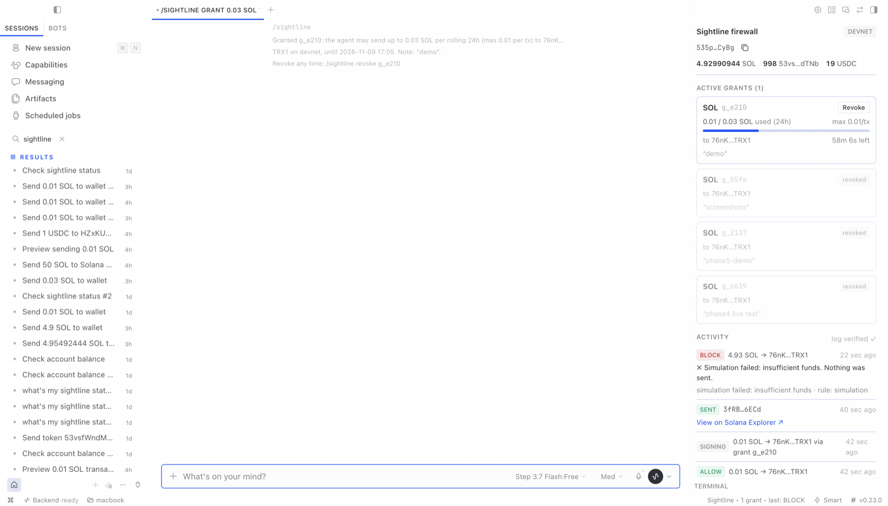
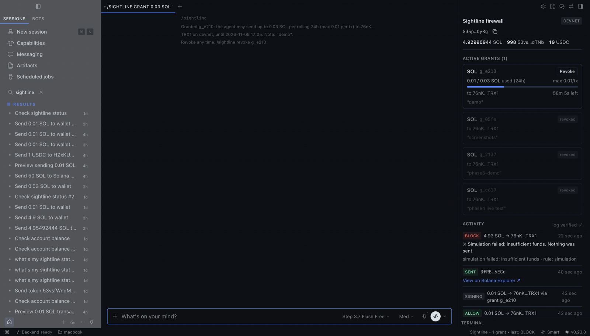
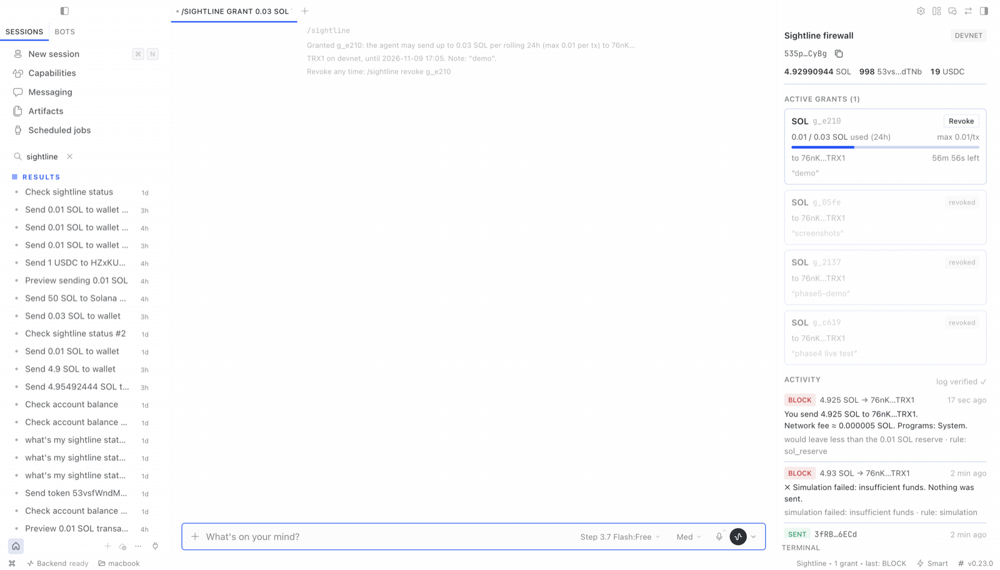
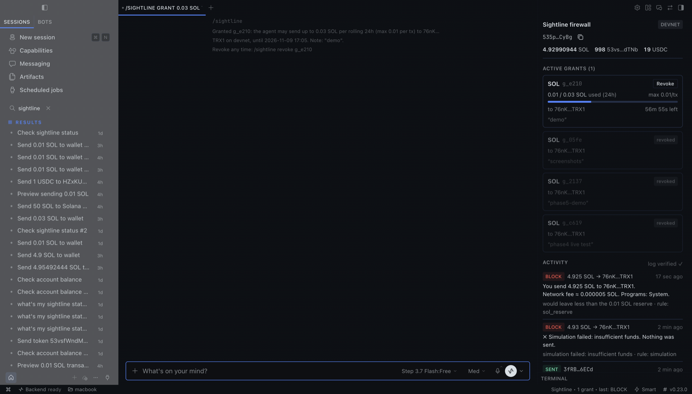

# Sightline

A Solana transaction firewall for [Hermes Agent](https://github.com/NousResearch/hermes-agent).

The agent gets intent-level wallet tools (balance, pay, later swap). Every signing
call passes a `pre_tool_call` hook that checks a user-issued, time-boxed, revocable
grant, simulates the transaction, explains it in plain English, and blocks or
approves it. The private key never reaches the model. Devnet by default.

**Status: Phases 0–4 done (devnet).** The agent pays only inside grants you issue;
anything else needs your approval or is blocked, and every decision lands in a
tamper-evident log.

## How it works

```
model ──sightline_pay──▶ pre_tool_call hook ──▶ build → simulate → firewall
                                  │                                  │
                         BLOCK / APPROVE (you) / ALLOW (grant)       │
                                  ▼                                  ▼
                         execute_intent: firewall again + reserve spend (atomic) → sign → send
                                  │
                                  ▼
                         hash-chained audit log  ◀── /sightline grant · revoke (you only)
```

## Grants (you, via slash command)

```
/sightline grant 5 USDC to 7xKq…9fP2 for 1h max 2 note "lunch"
/sightline grants
/sightline revoke g_4f2a        # or: /sightline revoke all
/sightline log 20
/sightline verify
```

Recipients must be named (`to any` is allowed but explicit). Defaults: 24h, max per
tx = daily cap. The model can read grants (`sightline_status`) but has no tool that
creates, widens or revokes them.

## Firewall

Hard blocks, which no grant or approval overrides: failed simulation, a mismatch
between the request and simulated effects, unknown programs, approve/authority/
close/assign instructions, dropping below 0.01 SOL, spending >90% of a token
balance at once, mainnet without opt-in. Inside a grant → sent. Otherwise → Hermes
asks you once; with nobody to ask, it is blocked. See
[docs/security-model.md](docs/security-model.md).

## Tools

| Tool | What it does |
|---|---|
| `sightline_status` | Network, RPC URL, wallet public key |
| `sightline_balance` | SOL + all SPL token balances (symbol when known) |
| `sightline_preview(recipient, amount, token="SOL")` | Dry run: simulate + explain, never signs |
| `sightline_pay(recipient, amount, token="SOL")` | Send SOL, a known symbol (`USDC`) or any mint; creates the recipient's token account if missing; returns signature + explorer link |

No tool accepts raw transactions or instructions, and the secret key is never
returned. Every payment goes through one choke point, `intents.execute_intent`:
build → simulate → explain → sign and send.

Example preview:

```
You send 1 USDC to 4FRE…wgaa.
Creates their USDC account (≈0.00148844 SOL rent). Network fee ≈ 0.000005 SOL. Programs: Associated Token, Token.
```

If the simulated balance changes don't match the request, a `⚠ Mismatch:` line is
added. See [docs/simulation-report.md](docs/simulation-report.md).

Mainnet is refused unless `SIGHTLINE_ALLOW_MAINNET=1`; a custom RPC is checked
against the mainnet genesis hash.

## Desktop pane

Hermes Desktop shows a **Sightline** pane: network, wallet and balances, active
grants with usage and a countdown (with **Revoke**), and a live activity feed of
every firewall decision. Turn it on in **Capabilities → Plugins**; open it with
⌘K → *Sightline: Open firewall* or the status-bar item. The pane can revoke a
grant but never create or widen one. See [docs/desktop-pane.md](docs/desktop-pane.md).

| Light | Dark |
|---|---|
|  |  |
|  |  |

## Install (local)

```bash
git clone https://github.com/OutstandingVick/sightline ~/sightline
ln -s ~/sightline ~/.hermes/plugins/sightline
hermes plugins enable sightline   # installs solana + solders
```

Set your wallet in `~/.hermes/.env`:

```
SIGHTLINE_SECRET_KEY=<base58 keypair>
# optional, defaults to https://api.devnet.solana.com
SIGHTLINE_RPC_URL=
# optional, mainnet is refused unless set to 1
SIGHTLINE_ALLOW_MAINNET=
```

After changing plugin code, restart Hermes (`hermes gateway restart`) so the
gateway reloads it.

Then ask Hermes: *"what's my sightline status?"*

## Devnet wallet

```bash
python scripts/new_devnet_wallet.py
```

Generates a keypair, prints the public key and base58 secret, and requests a
1 SOL airdrop. If the faucet rate-limits you, fund the address at
https://faucet.solana.com.

For an SPL token, see [docs/devnet-tokens.md](docs/devnet-tokens.md)
(`scripts/create_test_mint.py`, or devnet USDC from https://faucet.circle.com).

## Development

```bash
pip install "solana>=0.36,<0.37" "solders>=0.26,<0.27" pytest pyyaml fastapi httpx
pytest                              # offline, RPC is faked
node --test tests/js/*.test.mjs     # Desktop half against a stub SDK
SIGHTLINE_LIVE_TESTS=1 pytest tests/test_live_devnet.py   # sends 0.001 devnet SOL
hermes plugins doctor . --ci
hermes plugins validate . --install-deps
```

## Docs

- [Simulation report schema + samples](docs/simulation-report.md)
- [Simulation approach and RPC quirks](docs/phase2-notes.md)
- [Devnet test tokens](docs/devnet-tokens.md)
- [Security model](docs/security-model.md)
- [Desktop pane](docs/desktop-pane.md)
- [Troubleshooting](docs/troubleshooting.md)
- Live results: [Phase 1](docs/phase1-live-results.md), [Phase 2](docs/phase2-live-results.md), [Phase 3+4](docs/phase34-live-results.md), [Phase 5](docs/phase5-live-results.md)

## Disclosures

- Makes network calls to the configured Solana RPC (devnet by default).
- Reads `SIGHTLINE_SECRET_KEY` via Hermes' secret route; never returns it to the model.
- The Desktop pane reads `/api/plugins/sightline/state` (public data only) and can revoke grants.
- Stores grants and the audit log in Hermes' plugin data directory (`plugin_db("sightline")`).

## License

MIT
