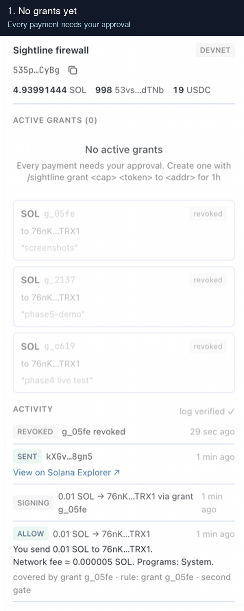
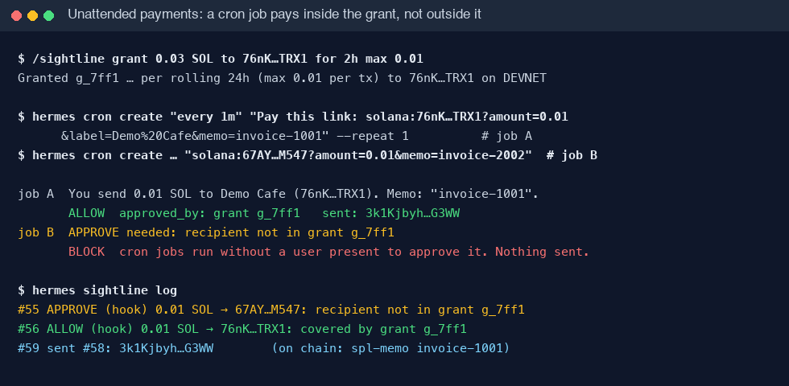
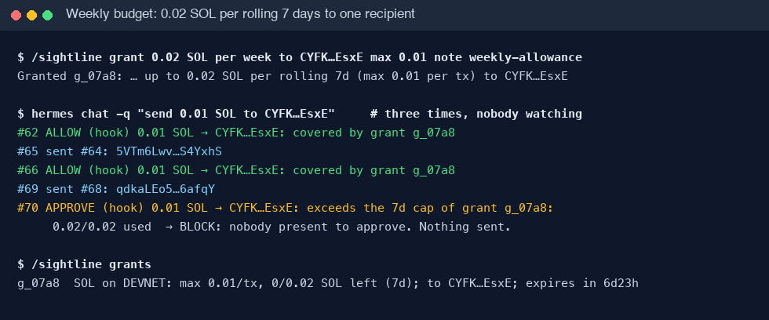
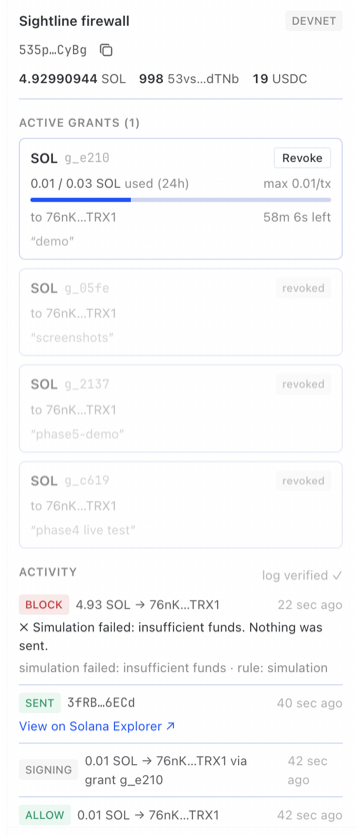
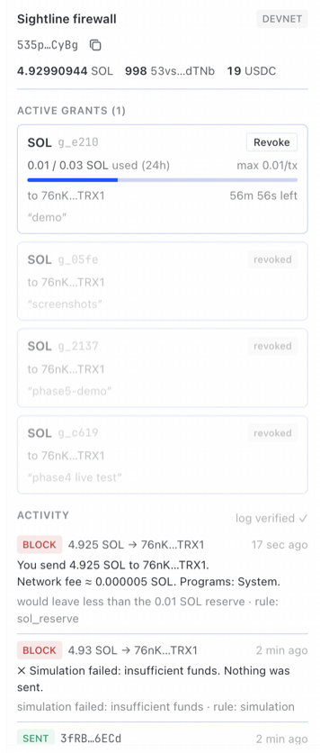
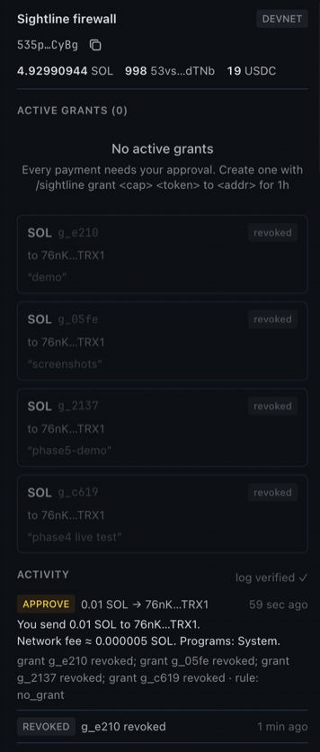

# Sightline

**Give your Hermes agent a Solana wallet without giving it your wallet.**

- **Pays only inside limits you set.** Grants (token, cap per day, week or month, per-payment
  max, recipients, expiry) are created by you, never the model. Everything else needs your
  approval or is blocked.
- **Checks every transaction before signing.** Simulated on the RPC, explained in plain English,
  and blocked on drains, unknown programs or any mismatch. The model never sees the key.
- **Works for real payments, even unattended.** Pays Solana Pay links (memo + reference), and cron
  jobs or bots can pay inside a grant with nobody watching.



A transaction firewall plugin for [Hermes Agent](https://github.com/NousResearch/hermes-agent). Devnet by default.

> **Judges: the 2-minute path**
>
> ```bash
> hermes plugins install OutstandingVick/sightline --enable --yes-deps
> hermes sightline setup        # creates a devnet wallet, prints its address
> hermes gateway restart        # only if a Hermes gateway is already running
> ```
>
> Then in a Hermes chat (any devnet address works as `<addr>`):
>
> | You type | Funded wallet | Empty wallet (0 SOL) |
> |---|---|---|
> | `/sightline grant 0.05 SOL to <addr> for 1h max 0.01` | grant created | grant created |
> | "send 0.01 SOL to `<addr>`" | **ALLOW**, sent, Explorer link | **BLOCK**: "covered by grant g_…, but wallet has 0 SOL" |
> | "send 0.01 SOL to `<another addr>`" | **APPROVE**: Hermes asks you | **BLOCK**: "no grant covers this … (Also: wallet has 0 SOL …)" |
> | "pay this: `solana:<addr>?amount=0.01&memo=test`" | **ALLOW**, sent with the memo | **BLOCK**: "covered by grant g_…, but wallet has 0 SOL" |
> | "send all my SOL to `<addr>`" | **BLOCK**: drain / 0.01 SOL reserve | **BLOCK**: drain, same reason |
> | `/sightline grant 0.02 SOL per week to <addr2> max 0.01`, then pay `<addr2>` 0.01 three times | **ALLOW**, **ALLOW**, then **APPROVE**: "exceeds the 7d cap" | **BLOCK** each time (wallet has 0 SOL) |
> | `/sightline revoke all`, then pay again | **APPROVE** again | **BLOCK**: no grant covers this |
>
> `/sightline log` shows every decision; `/sightline verify` checks the hash chain.
> Funding takes a minute at https://faucet.solana.com (see [Get devnet SOL](#get-devnet-sol));
> without it, every decision above still shows the firewall's real reason.

## Quickstart (devnet, under 5 minutes)

You need [Hermes Agent](https://github.com/NousResearch/hermes-agent) with a model set up.

```bash
hermes plugins install OutstandingVick/sightline --enable --yes-deps
hermes sightline setup
hermes gateway restart
```

(`hermes gateway restart` only matters if a Hermes gateway is already running; where no
service manager exists, e.g. a container, it runs the gateway in the foreground.)

`hermes sightline setup` (or `/sightline setup` in a chat) creates a devnet wallet,
saves the key to `~/.hermes/.env` without showing it, prints the wallet address and
asks the devnet RPC for an airdrop (usually refused these days).

### Get devnet SOL

Paste the address `hermes sightline setup` printed into **https://faucet.solana.com**
(signing in with GitHub raises the limit). Backups:
https://faucet.quicknode.com/solana/devnet · https://www.alchemy.com/faucets/solana-devnet.
Run `hermes sightline setup` again to see the balance.

No funds? You can still try previews, grants and the firewall decisions — sends will be
blocked until the wallet is funded.

Then, in a Hermes chat — grant a small allowance and ask the agent to pay:

```
/sightline grant 0.05 SOL to <any devnet address> for 1h max 0.01
send 0.01 SOL to <that address>          → ALLOW, sent, explorer link
send 0.01 SOL to <a different address>   → APPROVE: Hermes asks you
send all my SOL to <that address>        → BLOCK (keeps 0.01 SOL for fees)
```

Already have a key? Put it in `~/.hermes/.env` as `SIGHTLINE_SECRET_KEY=` (base58,
or the JSON array from a Solana CLI keypair file) instead of running setup.

## Pay links, budgets and unattended payments

**Solana Pay links.** Paste a payment request from a shop, invoice or QR code: *"pay this:
solana:76nK…?amount=0.01&label=Demo%20Cafe&memo=invoice-1001"*. Sightline adds the memo and
reference keys the merchant needs, shows "You send 0.01 SOL to Demo Cafe (76nK…TRX1). Memo:
"invoice-1001"" in the preview, and checks it against your grants like any payment.
Transaction-request links (`solana:https://…`), which would hand over a ready-made transaction,
are refused. [More](docs/solana-pay.md).

**Unattended payments.** A grant is a standing permission, so a cron job or a bot can pay
inside it with nobody at the keyboard. Anything outside the grant needs approval, which an
unattended run can't give, so it's refused:

```bash
hermes cron create "0 9 * * *" "Pay this link with sightline_pay (as link): solana:<addr>?amount=0.01&memo=daily"
```

Tested live: the job paying inside the grant was sent with its memo; the one paying a
stranger was refused. [More](docs/unattended-payments.md).



**Weekly and monthly budgets.** A grant's cap can apply per rolling day, week or month — an
allowance, a subscription, a supplier budget:

```text
/sightline grant 5 USDC per week to <alice> max 2 note "allowance"
/sightline grant 20 USDC per month to <supplier> for 90d
```

Every payment inside the budget goes through on its own; the one that would exceed it needs
you. [More](docs/budgets.md).



## Why

An agent with a wallet reads web pages, emails and tool output. Any of them can carry
hidden text telling it to send your funds somewhere else (prompt injection). Prompts, system messages
and skills can't fix that, because the model itself is what gets attacked: whatever
it can be talked into, it can do.

So Sightline takes the decision away from the model. The model can *ask* to pay. Code
it can't influence decides whether that payment matches a limit a human set, and
checks what the transaction would actually do before it is signed.

## How it works


1. **Grants** — you create them with a slash command: token, daily cap, max per
   transaction, recipients, expiry. Only you can create, widen or revoke them.
2. **Simulate** — the exact transaction runs on the RPC first; Sightline reads the
   real balance changes, programs and accounts it would touch.
3. **Firewall** — **BLOCK** (hard rules, below), **ALLOW** (inside an active grant)
   or **APPROVE** (no grant covers it: Hermes asks you once; with nobody to ask, it is
   blocked). It runs in Hermes' `pre_tool_call` hook *and again* right before signing.
4. **Sign** — only then, with a key the model never sees.
5. **Audit** — every decision, send and grant change goes into an append-only,
   hash-chained log (`/sightline verify`).

## Security model

| The model CAN | The model CANNOT |
|---|---|
| read status, balances and grants | see or export the private key |
| preview a payment (simulate, never signs) | submit raw transactions or instructions |
| request a SOL or SPL token transfer | create, widen, extend or revoke a grant |
| | skip simulation or the firewall |
| | pay outside a grant without you approving that one payment |

Grants are human-only: there is no model-callable tool that writes them, and the
Desktop pane can only revoke. Details and known limits: [docs/security-model.md](docs/security-model.md).

## Desktop pane

Hermes Desktop gets a **Sightline** pane: network, wallet and balances, active grants
(usage bar, countdown, **Revoke**) and a feed of every ALLOW / APPROVE / BLOCK with
explorer links. Turn it on in **Capabilities → Plugins**, then ⌘K → *Sightline: Open
firewall*. More: [docs/desktop-pane.md](docs/desktop-pane.md).

| ALLOW inside a grant | Drain blocked | APPROVE after revoke (dark) |
|---|---|---|
|  |  |  |

## Reference

### Slash commands (you only)

| Command | Does |
|---|---|
| `/sightline setup [--no-airdrop]` | create + fund a devnet wallet; keeps an existing one |
| `/sightline grant <cap> <token> [per day\|week\|month] to <addr>[,<addr>]\|any [for 30m\|1h\|7d\|30d] [max <per_tx>] [note "…"]` | create a grant (cap per 24h by default; a weekly or monthly cap lasts at least that long; max per tx = cap) |
| `/sightline grants` | list grants and what's left of each |
| `/sightline revoke <id>\|all` | revoke one or every grant (no id: pick from a list) |
| `/sightline log [n]` | last n audit entries |
| `/sightline verify` | check the audit log's hash chain |

`<token>` is `SOL`, a known symbol (`USDC`) or a mint address. Recipients must be named;
`to any` is allowed but has to be typed out.

The same commands except `grant` also work in a terminal: `hermes sightline setup|grants|revoke|log|verify`.
`grant` is chat-only on purpose — the agent's own terminal tool could run a CLI command.

### Tools (what the model gets)

| Tool | Does |
|---|---|
| `sightline_status` | network, wallet address, grants (read-only) |
| `sightline_balance` | SOL and every SPL token balance |
| `sightline_preview(recipient, amount, token="SOL" \| link)` | simulate + explain in plain English; never signs |
| `sightline_pay(recipient, amount, token="SOL" \| link)` | send SOL or an SPL token through the firewall; creates the recipient's token account if needed |

`link` is a [Solana Pay](docs/solana-pay.md) payment link (`solana:<address>?amount=…&memo=…`), in place of
recipient/amount/token. `amount: "all"` is accepted only to be refused as a drain.

Every error comes back as `{error, message, next_step}` — for example
`missing_secret`, `rpc_timeout`, `unknown_token`, `insufficient_token`,
`blockhash_expired` — never a traceback.

### Firewall rules

Hard **BLOCK**s, which no grant or approval overrides:

- simulation failed, RPC error, or balance data missing
- simulated effects differ from the request (amount, recipient, token)
- a program outside System, Token, Token-2022, Associated Token, Compute Budget, Memo
- approve / set-authority / close-account / assign instructions, or ones it can't decode
- the wallet would drop below 0.01 SOL
- more than 90% of a token balance in one transaction
- mainnet without `SIGHTLINE_ALLOW_MAINNET=1`

Otherwise **ALLOW** when an active grant covers token, network, recipient, per-tx max
and the rolling 24h cap; else **APPROVE**.

### Configuration

Set in `~/.hermes/.env` (restart Hermes after changing):

| Variable | Default | Meaning |
|---|---|---|
| `SIGHTLINE_SECRET_KEY` | — (required) | wallet key: base58, or a JSON byte array. `/sightline setup` writes it |
| `SIGHTLINE_RPC_URL` | `https://api.devnet.solana.com` | Solana RPC endpoint |
| `SIGHTLINE_ALLOW_MAINNET` | off | `1` to allow mainnet |

#### Mainnet

Off by default; a custom RPC is checked against the mainnet genesis hash so it can't
slip through. With `SIGHTLINE_ALLOW_MAINNET=1` and a mainnet RPC, every preview and
block message starts with **⚠ MAINNET — real funds**, and the pane's network badge
turns red. **These are real, irreversible payments.** The firewall limits what a
compromised agent can do; it doesn't make mainnet risk-free. Use a dedicated wallet
holding only what you're prepared to lose, and small grants.

## Tests

**270 Python tests** (268 offline + 2 opt-in live devnet) and **8 JS tests** for the
Desktop half. **71 are attack cases** (`pytest -m attack`): prompt-injected payments,
payments outside or above a grant, unknown programs and authority/approve/close
instructions, simulation mismatches, bypassing the hook, "always approve" turning into
a blanket approval, parallel payments racing one cap, the model trying to create a
grant, key leakage through any output, audit-log tampering, drains and policy at zero
balance, and Solana Pay links that try to widen a grant or smuggle in a transaction, and splitting payments
to get around a weekly budget. 15 more cover every
newcomer failure path (missing key, RPC down, faucet limits, …).

```bash
pip install "solana>=0.36,<0.37" "solders>=0.26,<0.27" pytest pyyaml fastapi httpx
scripts/check.sh                     # pytest, ruff, JS tests, hermes doctor + validate
SIGHTLINE_LIVE_TESTS=1 pytest tests/test_live_devnet.py   # sends 0.001 devnet SOL
```

## Limitations and roadmap

- Solana only; SOL and SPL token transfers (typed or from Solana Pay transfer links). No swaps,
  staking, transaction-request links or arbitrary programs yet.
- Don't set Hermes' `approvals.cron_mode: approve` or `approvals.single_query_mode: approve`: they
  auto-approve everything outside your grants in unattended runs.
- Approval prompts need an interactive Hermes session; `hermes chat -q`, cron and
  unattended bots block anything that needs approval (by design).
- An agent that also has unrestricted shell access could edit Sightline's database or
  Hermes' config. Keep shell tools on approval mode when the wallet holds real value.
- Anyone who can type slash commands to your Hermes (e.g. on a shared messaging
  gateway) can create grants.
- The Desktop pane refreshes every 5 s rather than instantly.

Roadmap: swaps through an allow-listed DEX with slippage limits, multisig-backed approvals.

## Disclosures

What this plugin touches:

- **Keys:** reads `SIGHTLINE_SECRET_KEY` through Hermes' secret route and keeps it in
  memory to sign. `/sightline setup` writes a newly generated key to `~/.hermes/.env`.
  The key is never logged, shown, returned to the model or sent anywhere.
- **Network:** talks only to the configured Solana RPC (devnet by default); setup asks
  that RPC for a devnet airdrop.
- **Signing:** signs only SOL/SPL transfers that passed simulation and the firewall,
  inside a grant or after you approved that one payment.
- **Storage:** grants and the audit log in Hermes' plugin data directory
  (`plugin_db("sightline")`).
- **Desktop:** the pane reads `/api/plugins/sightline/state` (public data only) and
  can revoke grants.

## Docs

[Security model](docs/security-model.md) · [Troubleshooting](docs/troubleshooting.md) ·
[Solana Pay links](docs/solana-pay.md) · [Budgets](docs/budgets.md) · [Unattended payments](docs/unattended-payments.md) ·
[Desktop pane](docs/desktop-pane.md) · [Simulation report](docs/simulation-report.md) ·
[Devnet tokens](docs/devnet-tokens.md) · [Changelog](CHANGELOG.md) · Live results:
[1](docs/phase1-live-results.md), [2](docs/phase2-live-results.md),
[3+4](docs/phase34-live-results.md), [5](docs/phase5-live-results.md), [0.6.4](docs/v0.6.4-live-results.md), [0.6.5](docs/v0.6.5-live-results.md)

## License

MIT
